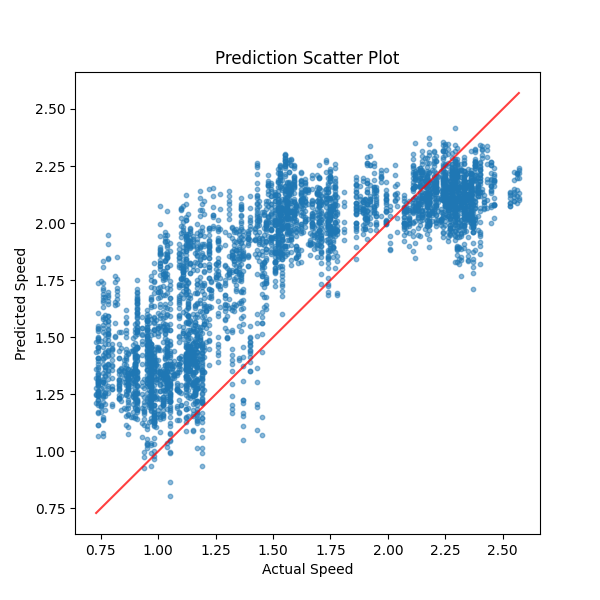
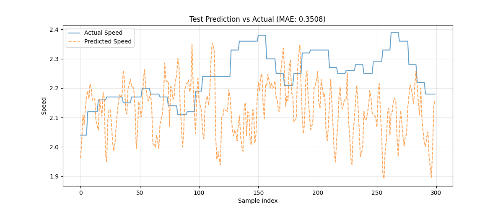
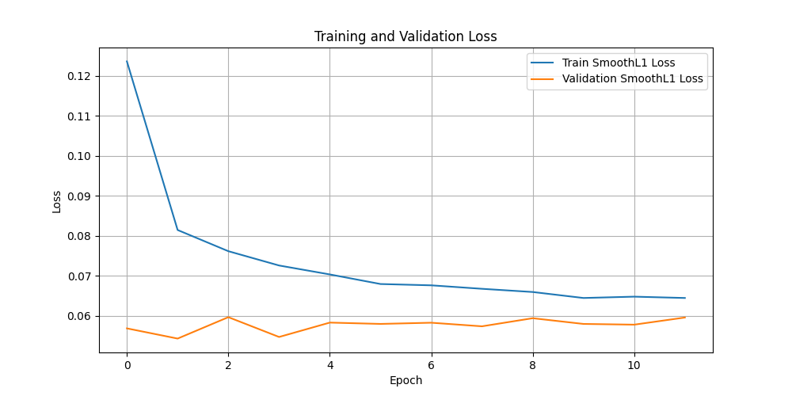
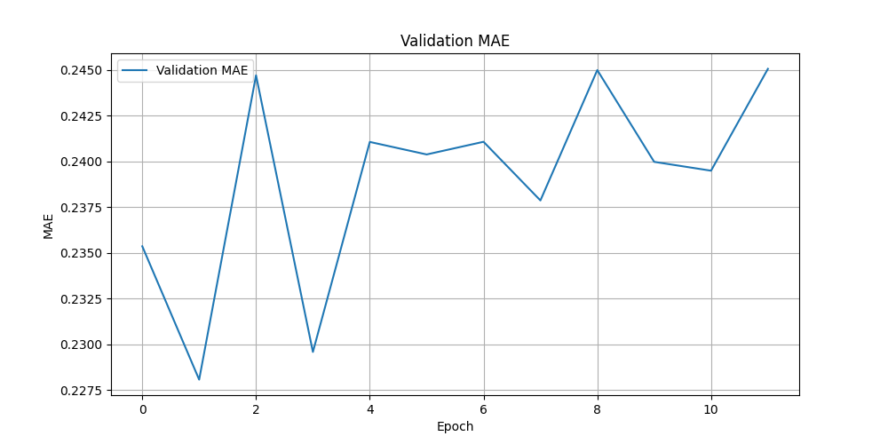

# Vehicle Speed Prediction Using CNN-LSTM

## Overview

This project explores vehicle speed prediction from sequences of camera images using deep learning.

The model combines a pretrained ResNet18 convolutional neural network (CNN) for spatial feature extraction with a Long Short-Term Memory (LSTM) network for temporal modeling.

The project covers data preprocessing, model training, hyperparameter experimentation, and performance evaluation.

## Technologies

- Python
- PyTorch and Torchvision
- ResNet18 and LSTM
- NumPy and Pandas
- OpenCV / PIL
- Matplotlib

## Project Structure

```text
code/
  dataset3_1.py
  model3_1.py
  split_data.py
  train3_1.py
  test3_1.py

results/
  prediction_scatter_run3_3.png
  prediction_vs_actual_run3_3.png
  train_val_loss_run3_3.png
  val_mae_run3_3.png

README.md
report.pdf
```

## Data Processing

The original data was extracted from ROS bag files containing camera images and vehicle speed measurements.

The processing pipeline includes:

1. Extracting and synchronizing images and speed measurements.
2. Preparing sequences of three consecutive images.
3. Splitting data chronologically into training (70%), validation (15%), and testing (15%) sets.
4. Applying image transformations and normalizing speed values.

The original dataset is not included in this repository.

## Model Architecture

The prediction model consists of:

- **CNN:** Pretrained ResNet18 for extracting visual features.
- **LSTM:** Temporal modeling of image sequences.
- **Fully Connected Layer:** Regression output for vehicle speed prediction.

The CNN parameters were frozen during training.

## Training Configuration

| Parameter | Value |
|---|---|
| Sequence length | 3 |
| Batch size | 16 |
| Maximum epochs | 50 |
| Learning rate | 0.00001 |
| Optimizer | Adam |
| Loss function | SmoothL1Loss |
| Early stopping patience | 10 |
| Learning rate scheduler | ReduceLROnPlateau |

## Experimental Results

Three evaluation runs were recorded.

| Run | Test MAE |
|---|---|
| Run 3-1 | 0.3563 |
| Run 3-2 | 0.3563 |
| Run 3-3 | 0.3508 |

The lowest recorded test MAE was **0.3508**.

### Prediction Scatter Plot



### Actual vs. Predicted Speed



### Training and Validation Loss



### Validation MAE



## Limitations

The model demonstrates some ability to learn relationships between visual information and vehicle speed. However, the results also show systematic prediction errors.

In particular, the model tends to overestimate lower speeds and underestimate higher speeds.

Further work could investigate alternative feature extraction strategies, temporal modeling approaches, and improved generalization.

## Documentation

A detailed project report is available in [report.pdf](report.pdf).

## Reproducibility

The source code is provided for educational and portfolio purposes. Reproducing the original experiments requires access to an appropriately prepared dataset and compatible software dependencies.

The dataset and trained model checkpoints are not included.

## Project Context

Developed as a Data Engineering / AI student project at Satakunta University of Applied Sciences (SAMK), Finland, in 2026.